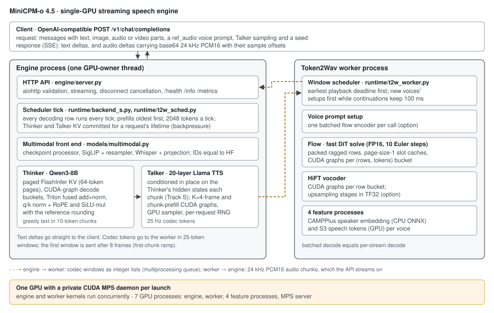
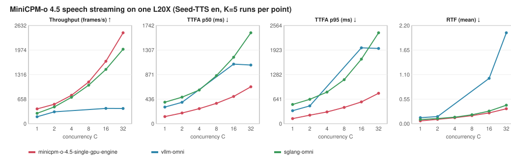

# MiniCPM-o 4.5 · Single GPU

A dedicated streaming speech engine for [MiniCPM-o 4.5](https://huggingface.co/openbmb/MiniCPM-o-4_5) on one GPU.
The Thinker (Qwen3-8B) and the Talker (20-layer Llama TTS) share one process, a paged FlashInfer KV runtime and CUDA
graphs. The Talker is conditioned in place on the Thinker's hidden states while the reply is still being generated.
Token2Wav (flow-matching DiT and HiFT) runs in a worker process beside it under CUDA MPS. The server speaks the
OpenAI-compatible `/v1/chat/completions` API with streamed text and 24 kHz audio.

## Architecture



[Module details and configurations](docs/architecture.md) ·
[Implemented optimizations and experiment results](docs/optimizations.md) ·
[Why the target is not met yet](docs/performance-gap.md)

## Quickstart

Requires Linux, Python 3.12, `uv`, a CUDA 13 driver and one GPU. The measured profiles use about 95 GB of GPU memory
(measured on an L20X with 143 GB). The lock pins torch 2.13 (cu130), transformers 5.14 and flashinfer 0.7. `minicpmo-utils` provides the
reference Token2Wav modules. It is installed without its dependencies, which the lock already lists.

```bash
git clone https://github.com/InferMatrixLab/minicpm-o-4.5-single-gpu-engine.git
cd minicpm-o-4.5-single-gpu-engine

uv venv --python 3.12 .venv-engine
uv pip install --python .venv-engine/bin/python --no-deps \
  --index-strategy unsafe-best-match --extra-index-url https://download.pytorch.org/whl/cu130 \
  -r engine/env/engine.lock

hf download openbmb/MiniCPM-o-4_5 --revision 503e754207c94da6bb26850b4469f367c9ea3582

CUDA_VISIBLE_DEVICES=0 ENGINE_MPS=1 scripts/serve_engine.sh track_s_fast 18080
```

`scripts/serve_engine.sh <config> <port>` loads `configs/engine/<config>.json`. With `ENGINE_MPS=1` it starts a
private CUDA MPS daemon for the engine and the worker, addresses the GPU by UUID, and removes the daemon when the server
exits. The checkpoint is found in the Hugging Face cache (`HF_HUB_CACHE`) or at `MODEL_PATH`. Every machine-specific
location is listed in [`scripts/env.sh`](scripts/env.sh) and can be set in an untracked `scripts/env.local.sh`.
The server is ready after model loading, CUDA graph capture and the feature-process warmup; the first start also
compiles the Token2Wav kernels.

From another terminal:

```bash
curl --fail http://127.0.0.1:18080/health
REF="${HF_HUB_CACHE:-$HOME/.cache/huggingface/hub}"/models--openbmb--MiniCPM-o-4_5/snapshots/503e754207c94da6bb26850b4469f367c9ea3582/assets/HT_ref_audio.wav
printf '{"model": "openbmb/MiniCPM-o-4_5", "stream": true, "modalities": ["text", "audio"],
 "messages": [{"role": "user", "content": "Please read the following text out loud in English: Hello from MiniCPM-o."}],
 "chat_template_kwargs": {"use_tts_template": true, "enable_thinking": false},
 "max_tokens": 256, "temperature": 0, "seed": 1, "ref_audio": "data:audio/wav;base64,%s"}' "$(base64 -w0 "$REF")" > body.json
curl --fail-with-body -N http://127.0.0.1:18080/v1/chat/completions \
  -H 'Content-Type: application/json' --data-binary @body.json
```

Text arrives as `{"modality": "text", "choices": [{"delta": {"content": ...}}]}` and audio as
`{"modality": "audio", "audio_offset_samples": o, "num_samples": n, "choices": [{"delta": {"content": <base64 WAV>}}]}`
(24 kHz, mono, 16-bit PCM). The default Talker sampling is the model card's (temperature 0.8, top-p 0.85, top-k 25,
repetition penalty 1.05 over 16 frames); `talker_sampling` overrides it per request. Image, audio and video inputs use
the usual `image_url`, `input_audio`/`audio_url` and `video_url` content parts. See [API and request flow](docs/architecture.md).

## Performance

<!-- latest-performance:start -->
Recorded on **one L20X** (143 GB, driver 570.133.20) with the same Seed-TTS English voice-cloning requests at each
concurrency: 320 evaluation requests per run (640 at C=32), a warmup, a discarded first run, then **K=5 measured
runs** on a freshly started server each. Rows are means over the K runs. Versions:
MiniCPM-o 4.5 [`503e754`](https://huggingface.co/openbmb/MiniCPM-o-4_5/tree/503e754207c94da6bb26850b4469f367c9ea3582),
vLLM-Omni [`2ec5f26`](https://github.com/vllm-project/vllm-omni/commit/2ec5f265c69520cdd5e5f0a19db485d38885843e),
SGLang-Omni [`22d4ace`](https://github.com/sgl-project/sglang-omni/commit/22d4ace88f9547777b819a69d7691204bb9ce847).

| C | Framework | Config | Throughput (frames/s) | Throughput / SGLang | TTFA p50 (ms) | TTFA p95 (ms) | RTF (mean) |
|---:|---|---|---:|---:|---:|---:|---:|
| 1 | minicpm-o-4.5-single-gpu-engine | `track_s_fast_r11` | 397.43 | 1.43× | 126.2 | 133.2 | 0.0635 |
| 1 | vllm-omni | `minicpmo_4_5_turn_mps-mps-on` | 187.52 | 0.67× | 295.3 | 339.9 | 0.1354 |
| 1 | sglang-omni | `speech-mm32k` | 278.72 | 1.00× | 381.2 | 502.9 | 0.0931 |
| 2 | minicpm-o-4.5-single-gpu-engine | `track_s_fast_r11` | 521.11 | 1.16× | 190.2 | 222.5 | 0.0975 |
| 2 | vllm-omni | `minicpmo_4_5_turn_mps-mps-on` | 318.61 | 0.71× | 380.0 | 465.1 | 0.1596 |
| 2 | sglang-omni | `speech-mps-on` | 450.37 | 1.00× | 471.0 | 637.7 | 0.1152 |
| 4 | minicpm-o-4.5-single-gpu-engine | `track_s_fast_r11` | 761.92 | 1.07× | 267.1 | 308.2 | 0.1335 |
| 4 | vllm-omni | not evaluated at this C | — | — | — | — | — |
| 4 | sglang-omni | `speech-mps-on` | 709.73 | 1.00× | 597.6 | 825.6 | 0.1463 |
| 8 | minicpm-o-4.5-single-gpu-engine | `track_s_fast_r11` | 1118.93 | 1.08× | 361.4 | 425.6 | 0.1817 |
| 8 | vllm-omni | not evaluated at this C | — | — | — | — | — |
| 8 | sglang-omni | `speech-mps-on` | 1033.40 | 1.00× | 853.9 | 1150.4 | 0.2001 |
| 16 | minicpm-o-4.5-single-gpu-engine | `track_s_fast_r11` | 1674.36 | 1.15× | 483.5 | 569.6 | 0.2422 |
| 16 | vllm-omni | `minicpmo_4_5_turn_mrv2_h200_mps-mps-on` | 411.03 | 0.28× | 1057.2 | 1982.3 | 1.0148 |
| 16 | sglang-omni | `speech-mps-on` | 1455.39 | 1.00× | 1179.2 | 1686.0 | 0.2829 |
| 32 | minicpm-o-4.5-single-gpu-engine | `track_s_fast_r11` | 2437.10 | 1.22× | 654.6 | 794.6 | 0.3345 |
| 32 | vllm-omni | `minicpmo_4_5_turn_mrv2_h200_mps-mps-on` | 407.68 | 0.20× | 1041.1 | 1965.6 | 2.0344 |
| 32 | sglang-omni | `speech-mps-off` | 1996.67 | 1.00× | 1613.0 | 2374.3 | 0.4137 |



`C` is the number of concurrent requests. Throughput counts returned audio as 25 Hz codec frames
(25 × delivered seconds / wall time); TTFA is the time to the first audio sample; RTF is each request's time to its
last audio sample divided by its audio duration. Baseline configurations were chosen per concurrency on separate
tuning requests and then measured on the evaluation requests. vLLM-Omni won no metric at C=4 and C=8 during tuning, so
it was not measured there. Where two SGLang-Omni configurations were measured at one C, the faster one is shown; the
target ratios use the configuration selected on the tuning requests for each metric.

**Target status: not met.** The goal is 2× the better baseline on every metric at every C, with the one-sided 95%
bootstrap lower bound (LCB) at or above 2.0. TTFA reaches it in 10 of 12 cells. Throughput and RTF reach 1.07–1.47×
(LCB 1.06–1.46).
The `track_s_fast_r11` profile also exceeds the Token2Wav HiFT error bound on 1 of 190 chunks (1.06e-2 against
1e-2) and has not yet passed the speech quality gates, so it is a measured profile, not a qualified headline.
[Ratios, quality status, run ranges and raw evidence](docs/current-results.md).
<!-- latest-performance:end -->

## References

- [MiniCPM-o 4.5](https://huggingface.co/openbmb/MiniCPM-o-4_5): checkpoint, processor, encoders and the
  `streaming_generate` reference ported here.
- [minicpmo-utils](https://pypi.org/project/minicpmo-utils/) (`stepaudio2`): the reference Token2Wav, CosyVoice2 flow and
  HiFT modules.
- [FlashInfer](https://github.com/flashinfer-ai/flashinfer), [Triton](https://github.com/triton-lang/triton) and
  [PyTorch](https://github.com/pytorch/pytorch): GPU operators and CUDA graphs.
- [vLLM-Omni](https://github.com/vllm-project/vllm-omni) and [SGLang-Omni](https://github.com/sgl-project/sglang-omni):
  serving baselines and the speech evaluation tools (Seed-TTS WER, speaker similarity).
- [Seed-TTS eval](https://huggingface.co/datasets/zhaochenyang20/seed-tts-eval): the voice-cloning workload.
- [OmniRSI](https://github.com/ThinkFlowLab/OmniRSI): recorded optimization knowledge and evidence.

See [NOTICE](NOTICE) and the [Apache-2.0 license text](third_party_licenses/Apache-2.0.txt) of the reused code.
